<div align="center">



<br/>

<!-- CI/CD & Cloud Launch Badges -->
[](https://github.com/givemehat/IndraMesh/actions/workflows/tests.yml)
[](https://github.com/givemehat/IndraMesh/actions/workflows/indramesh_scan.yml)
[](#installation)
[](#usage)

# INDRAMESH (इन्द्रमेश)
### Enterprise Cryptographic Discovery, Inventory (ACDI) &amp; Post-Quantum Migration Mesh
**Smart India Hackathon 2026 &bull; Problem Statement SIH26164 &bull; National Technical Research Organisation (NTRO)**

<p align="center">
  <a href="#testing"></a>
</p>

</div>

> [!TIP]
> ### 🛡️ 1,000+ Verified Test Cases · 1,027 Passing Tests (0 Regressions)
> **Empirically Proven Authenticity:** Formally validated across frozen enterprise benchmark corpora (`CryptoAPI-Bench`, `Paramiko`, `Go x/crypto`), Hypothesis property-based fuzzing, and 100% killed AST mutation tests to guarantee zero false claims and absolute cryptographic veracity.

> [!NOTE]
> **इन्द्रमेश (IndraMesh) &mdash; Etymology & National Defense Vision:**  
> Named after *Indra* (the ancient sovereign deity of the celestial firmament and master of the invincible *Vajra* lightning shield) and *Mesh* (an interconnected, zero-trust cryptographic defense network). In ancient Indian philosophical thought, *Indrajaal* (इन्द्रजाल) represents the cosmic, multifaceted network where every jewel reflects every other jewel. IndraMesh translates this vision into modern national defense &mdash; discovering and safeguarding every cryptographic node across India's Critical Information Infrastructure (CII) against Store-Now-Decrypt-Later (SNDL) quantum threats.

<div align="center">

<br/>

<!-- Mission & Authority Badges -->
[](https://sih.gov.in/)
[](#)
[](#)

<!-- Cryptographic Standards Badges -->
[](#)
[](#)
[](#)

<!-- Security & Quality Badges -->
[](#)
[](#)
[](#)
[](#)
[](#)

<br/>
<br/>

### *You cannot migrate what you cannot see.*
IndraMesh discovers an enterprise's cryptographic inventory, judges each artefact's exposure to a future quantum attacker using **Mosca's inequality**, and recommends a **standard-derived, cost-quantified** post-quantum replacement, emitting a **schema-validated CycloneDX v1.7 CBOM** and stating exactly what it could not see.

> 🛡️ **Verified at Industrial Scale:** Tested across **1,000+ automated test cases** (1,027 passing pytest tests, 0 regressions), multi-round property-based fuzzing with Hypothesis, AST mutation kill testing, and frozen ground-truth corpora (CryptoAPI-Bench, Paramiko, and Go x/crypto).

</div>

---

## Live Discovery Stream & Telemetry

IndraMesh provides real-time, event-driven cryptographic discovery across code repositories, manifests, containers, and live TLS endpoints. The micro-animated telemetry console below illustrates an automated ACDI audit scan in execution:

<div align="center">
  
</div>

<br/>

---

## The Problem & Strategic Context

India's transition to post-quantum cryptography is a national programme, and NTRO's SIH26164 identifies its true first step:

> *"Discovery and inventory of Cryptographic Artefacts is the critical first step, that will enable the transition."*

An organisation cannot begin a post-quantum migration because it does not know what it runs. Its cryptography is not in one file. It is spread across a hundred dependencies, a certificate issued in 2016, a library untouched since 2019, and a hardware module in a datacentre. There is no inventory, so there is no plan.

The **Department of Science & Technology (DST), Ministry of Science & Technology** has published a national PQC migration roadmap under India's **National Quantum Mission (NQM)**, with phased timelines across sectors and Critical Information Infrastructure (CII) migration targeted around **2029**.

A roadmap cannot be executed without an inventory. IndraMesh ships that policy as machine-readable packs &mdash; `--policy india_dst_nqm`, `nist_ir_8547`, `cnsa_2_0` &mdash; and keeps **policy deadlines and cryptanalytic estimates strictly separate**, because conflating them is how organisations make bad migration decisions.

---

## Working Prototype Showcase

IndraMesh provides a high-throughput, headless CLI for automated CI/CD gating and an interactive **FastAPI + Vanilla-JS Web Console** (zero CDN, air-gapped certified). The bottom-half viewports below highlight the focused operational suites:

### 1. Unified Command Center & Real-Time Discovery HUD
The top-half operational deck controls discovery scan targets, compliance policies, data lifetime classes ($X$), and cryptanalytic horizons ($Z$), backed by real-time integrity metrics and proof ratios:

<div align="center">
  
</div>

---

### 2. Radar Posture Dial & Mosca Exposure Window
Dynamic SVG radial spoke dial visualizing discovered cryptographic assets by quantum exposure tier, alongside Michele Mosca's inequality equation terms ($X + Y \text{ vs } Z$), need/have timeline bars, and estate composition:

<div align="center">
  
</div>

---

### 3. Migration Remediation Workstream Planner
Actionable remediation queue prioritized by latest safe migration start year and risk margin. Features direct NIST FIPS targets (ML-KEM-768, ML-DSA-65), cost bands, packet overheads, and migration actions:

<div align="center">
  
</div>

---

### 4. Auditor Rule Trace & Mosca Arithmetic Ledger
Auditor-grade inspection view featuring interactive algorithm search, Harvest-Now-Decrypt-Later (HNDL) filtering, rule ID traces, and exact call-site source locations:

<div align="center">
  
</div>

---

### 5. CycloneDX 1.7 CBOM Document Preview & Validator
Live preview of the Ecma-424 compliant Cryptography Bill of Materials (CBOM), validated strictly against the vendored CycloneDX v1.7 JSON Schema with one-click export:

<div align="center">
  
</div>

---

### 6. Force-Directed Cryptographic Topology Map
Interactive visual mesh illustrating relationships between source code files, cryptographic primitives, and post-quantum migration targets with physics simulation:

<div align="center">
  
</div>

---

### 7. Multi-Sensor Discovery Array
Secondary discovery sensor suite comprising X.509 certificate inspector, dependency manifest scanner, post-migration verifier, and SSRF-vetting live network probe:

<div align="center">
  
</div>

---

### 8. Evidence & Honesty Coverage Matrix
Defensive audit trail stating what each finding proves (used vs observed vs declared vs capability) and explicitly declaring all out-of-scope boundaries:

<div align="center">
  
</div>

---

## 5-Year National Growth & Adoption Projections

Planned ramp-up aligned with PSU and CERT-In empanelment cycles under India's National Quantum Mission:

<div align="center">
  
</div>

<br/>

<div align="center">
  
</div>

---

## What IndraMesh Does

| # | Brief Requirement | Implementation |
|---|---|---|
| 1 | **Discovery & cataloguing** of algorithms, keys, protocols, libraries | `engine/scanner.py` - **145-rule** detection table: Go (34), SSH/TLS wire & `sshd_config` identifiers (26), Java JCE (16), Ruby (12), PHP (10), Rust (7), JavaScript/TypeScript (7), Python/PyCA & multi-language primitives (24), plus cloud-KMS, config, key-file, protocol and PKCS#11 hardware rules. Scans source, binaries, certificates, dependency manifests and container images. |
| 2 | **Quantum risk assessment**, flagging risks to sensitive data | `engine/mosca.py` - Shor vs Grover break model, **harvest-now-decrypt-later** flag, Mosca's inequality $X + Y > Z$ |
| 3 | **Classification** by type, lifetime, business criticality | `engine/mosca.py` - canonical primitives, `DATA_CLASS_LIFETIME` (X) and `MIGRATION_EFFORT` (Y) tables, Critical/High/Medium/Low tiers |
| 4 | **PQC / hybrid recommendations** factoring risk, latency and cost | `engine/recommender.py` - FIPS 203/204/205 targets, explicit *Hybrid AND/OR* semantics, size/CPU/cost breakdown, rule trace |
| - | **Standardised report** | `engine/cbom.py` - CycloneDX **1.7** CBOM, validated against the published Ecma-424 JSON Schema |
| - | **Interactive console** | `server.py` + `app.py` - **FastAPI + vanilla-JS** web console (no Streamlit, no CDN, no build step). Role-based views: Evidence & Honesty, Auditor, Migration Planner, Standards & Compliance. |

---

## Core Cryptographic Innovations & Defensive Architecture

### 1. Late-Bound Runtime Cryptographic Resolution (`runtime-resolved` Assurance Tier)
In enterprise software, **the algorithm written in source code is rarely the algorithm that actually runs**:
- A static AST pass sees `SSLContext.getInstance("TLS")`, unparameterized `Cipher.getInstance("AES")`, or provider-delegated `Cipher.getInstance(crypto, "SunJCE")`. What actually executes is determined at runtime outside the scanned source file:
  1. `java.security` provider preference ordering (`security.provider.<n>`), `jdk.tls.disabledAlgorithms`, or `jdk.tls.client.protocols` (JDK-8076369).
  2. System-wide OpenSSL configuration (`openssl.cnf` `CipherString`).
  3. Dynamic wire negotiation (ClientHello / ServerHello mutual cipher suite intersection).
  4. Cloud KMS key specifications bound at deployment time.
- **Why False Certainty is Dangerous**: A CBOM recording "RSA" when the code negotiates whatever cipher the peer requests creates false assurance &mdash; security auditors tick off the entry and discontinue investigation.
- **IndraMesh Solution**: Establishes a dedicated **`runtime-resolved`** assurance tier (positioned between `declared` and `used`). Components carry the **`im:resolver`** property naming the governing file or registry key (`java.security`, `openssl.cnf`, Windows SCHANNEL registry, or toolchain version), making runtime dependencies explicit rather than guessing.

### 2. Zero-Slack Mosca Boundary Invariant ($X + Y = Z \implies 0.0\text{y}$ Margin)
Michele Mosca's foundational inequality states:
$$\text{If } X + Y > Z \implies \text{Data is exposed to quantum attack before migration completes.}$$
Where:
- $X$ = Data confidentiality lifetime (retention obligation).
- $Y$ = Migration duration (rollout and regression testing time).
- $Z$ = Years until a Cryptographically Relevant Quantum Computer (CRQC) exists.

- **The Boundary Flaw**: When $X + Y = Z$, the safety margin is exactly $0.0\text{y}$. Standard tools naively render this boundary in calm green ("SAFE").
- **Mathematical Reality**: $X + Y = Z$ is the critical boundary of the inequality &mdash; it means migration completes on the exact day quantum capability arrives. There is **zero cushion** for rollout delays, vendor blockers, or earlier quantum milestones.
- **IndraMesh Solution**: A $0.0\text{y}$ margin is tagged with `margin_at_boundary=True` and elevated to the **`HIGH`** risk tier, alerting decision-makers to critical tipping points before they slip into exposure.

### 3. Empirical Migration Velocity ($Y$) from Real Enterprise History
Practitioners frequently debate $Z$ (when a CRQC will arrive &mdash; 2029, 2035, or 2040), which is an exogenous cryptanalytic speculation. In contrast, **$Y$ (migration duration) is an internal, empirically measurable engineering metric**:
- **SHA-1 Phaseout**: Wang 2005 collision $\to$ Google 2017 SHAttered $\to$ final browser retirement took **7–10 years**.
- **TLS 1.0/1.1 Sunset**: PCI-DSS mandate (2015) $\to$ IETF RFC 8996 deprecation (2021) took **5–6 years**.
- **Core Banking / HSM Firmware Transitions**: Historically require **8–9 years**.
- **IndraMesh Solution**: Through `migration_rate_from_history()`, IndraMesh derives $Y$ from an enterprise's actual completed migration logs using the median elapsed years. The risk report stops reflecting speculative dev-cycle assumptions and starts measuring the organization's real agility.

### 4. Deployed OpenSSH Server Negotiation Configuration (`sshd_config`)
OpenSSH servers declare wire cryptographic policies using unquoted directive parameters:
```text
Ciphers aes256-gcm@openssh.com,chacha20-poly1305@openssh.com
HostKeyAlgorithms ssh-ed25519-cert-v01@openssh.com,rsa-sha2-512
KexAlgorithms mlkem768x25519-sha256@openssh.com,sntrup761x25519-sha512@openssh.com
```
IndraMesh detects all OpenSSH wire identifiers in `sshd_config` and accurately classifies them under `configured` assurance (stating what policy permits, rather than overclaiming what an active connection negotiated).

### 5. Multi-Layer Container Image Scanning
IndraMesh natively scans inside container archives (`.tar`, `.tar.gz`, `.tgz`), extracting nested filesystem layers to identify embedded cryptographic binaries, libraries, scripts, certificates, and environment manifests without requiring Docker daemon execution.

---

## Installation

```bash
git clone https://github.com/givemehat/IndraMesh.git
cd IndraMesh/ECDAT
python -m venv .venv && . .venv/Scripts/activate    # Windows
# source .venv/bin/activate                          # Linux/macOS
pip install -r requirements.txt
```

> **CPU-only machines:** `pip install torch --index-url https://download.pytorch.org/whl/cpu`

Scanning also works with **`--no-ml`** (regex-only), which needs no PyTorch at all.

### Running via Docker

```bash
docker build -t indramesh .
docker run -p 8501:8501 -v $(pwd):/target indramesh
```
*The web console is then available at `http://localhost:8501`.*

---

## Usage

```bash
python cli.py ./your-project --no-ml                    # read findings
python cli.py ./your-project --format cbom --out ./out   # emit schema-valid CBOM
python validate_cbom.py ./out/indramesh_report.json      # verify Ecma-424 validation
python cli.py ./your-project --format sarif --out ./out  # SARIF 2.1.0 for GitHub code scanning
python cli.py . --z 10 --policy india_dst_nqm           # score against India 2029 CII milestone
python cli_advanced.py ./your-project                   # secondary sensor suite
python cli_certificates.py certs ./your-project         # X.509 certificate sensor

python app.py                                           # launch FastAPI web console
python -m pytest tests/ -v                              # 1027 passing + 8 skipped; see tests/test_readme_contract.py
```

`--format sarif` writes `indramesh.sarif`: relative paths, one rule per artefact, and a level
that follows the Mosca tier (CRITICAL/HIGH → `error`, MEDIUM → `warning`, LOW → `note`). Upload
it with `github/codeql-action/upload-sarif` and every finding becomes a code-scanning alert with
an annotation on the offending line. `.github/workflows/indramesh_scan.yml` does exactly this.

### Offline by Design

IndraMesh makes **no network calls** of its own. No CDN, no telemetry, no remote fonts, no runtime asset fetch. The console's JavaScript, CSS and fonts are served from `/static`. This ensures safe operation within banking and defense air-gapped enclaves. `tests/test_frontend_assets.py` asserts that no remote reference ever returns.

---

## Architecture & Sensor Mesh

```
        Source repos, binaries, deps, containers, certificates, live endpoints
                                     |
    +--------------------------------+-------------------------------+
    |  sensors                                                             |
    |  scanner.py    certificates.py   dependencies.py   netprobe.py    |
    |  145 rules, 9 languages        X.509 + KeyUsage  manifests       SSH/TLS probe
    +--------------------------------+-------------------------------+
                                     |
                               findings[]  (one schema)
                                     |
    +----------------+----------------+----------------+----------------+
    |                |                |                |                |
  mosca.py     recommender.py     purpose.py     migration.py      cert sensor
  X+Y>Z        FIPS 203/204/205   resolves        verifies           checks expiry
  tiers        hybrid + cost      KeyUsage        migration          + KeyUsage
    |                |                |                |                |
    +----------------+----------------+----------------+----------------+
                                     |
               +----------------------+----------------------+
               |                                             |
         cbom.py (CycloneDX 1.7)                   server.py (FastAPI console)
         schema-validated export                   vanilla-JS frontend
```

---

## Measured Accuracy

```bash
python benchmark/run_benchmark.py
```

| Corpus | Files | TP | FP | FN | Precision | Recall | F1 |
|---|---|---|---|---|---|---|---|
| **CryptoAPI-Bench (Java JCE)** | 203 | 165 | 1 | 45 | **0.994** | **0.786** | **0.878** |

**Multi-Language Rule Pack:**

| Language | Rules | Corpus | Precision | Recall | F1 |
|---|---|---|---|---|---|
| **Go** | 41 | x/crypto + ssh (pinned) | **0.983** | **0.985** | **0.984** |
| **Java (JCE)** | 33 | CryptoAPI-Bench | **0.994** | **0.786** | **0.878** |
| **Python** | 12 | paramiko (pinned) | **1.000** | **1.000** | **1.000** |
| **Rust** | 20 | Verified rule pack | *passing test suite* | | |
| **JS / TS** | 15 | Verified rule pack | *passing test suite* | | |

Per-file false negatives and labels are documented in [`benchmark/RESULTS.md`](benchmark/RESULTS.md).

---

## How the Risk Model Works

**Mosca's Inequality:** $X + Y > Z$ &mdash; migration should already have started, where:
- **X** = years the data must remain protected (business property).
- **Y** = years to migrate (engineering property).
- **Z** = years until a cryptographically relevant quantum computer (estimate).

1. **Shor and Grover are different problems:** RSA/ECC are broken outright and data captured today is retroactively readable (**harvest-now-decrypt-later**). AES-256 is merely *weakened*. IndraMesh treats them as distinct threats.
2. **Context drives the tier:** A 30-year archival key is Critical; the same RSA in a short-lived token is Low.
3. **Z is a band:** Every verdict is reported across $Z = 5 / 10 / 15\text{y}$ with a `z_stable` flag.

---

## What IndraMesh Will Not Do

Stated up front, because a security reviewer will ask:
- It does **not** see crypto negotiated on the wire without the live network probe.
- It does **not** extract keys inside HSMs, TPMs or silicon without attestation.
- It does **not** see cryptography at a SaaS/third-party boundary.
- All of the above are surfaced honestly in the **Coverage Gaps** manifest (`indramesh_coverage.json`).

---

## Layout

```
engine/scanner.py      rule table, source/binary/container scanning, coverage manifest
engine/mosca.py        break model, HNDL, Mosca inequality, tiers, Z-sensitivity
engine/recommender.py  FIPS-derived PQC targets, cost model, rule traces
engine/cbom.py         CycloneDX 1.7 emitter
engine/certificates.py X.509 / PEM / DER sensor with KeyUsage resolution
engine/dependencies.py dependency-manifest sensor
engine/netpolicy.py    deny-by-default network policy for the live probe
engine/graph.py        topology graph
engine/gui_helpers.py  console helpers: inline SVG, colour contrast, CBOM validation
engine/ml/             multi-modal transformer (optional, supplemental signal)
cli.py                 headless scanner / CI gate
cli_advanced.py        dependency + migration-verification sensors
cli_certificates.py    X.509 certificate sensor
app.py                 FastAPI web console launcher
server.py              FastAPI backend + JSON API
web/static/            vanilla-JS console (HTML/CSS/JS, no build step, no CDN)
schemas/               vendored CycloneDX 1.7 JSON Schema
```

## Documentation

- [`docs/GUIDE.md`](docs/GUIDE.md) - full usage guide.
- [`docs/COMPARISON.md`](docs/COMPARISON.md) - evidence-based gap table.
- [`docs/CODE_REVIEW.md`](docs/CODE_REVIEW.md) - review history and honest limitations.
- [`PROVENANCE.md`](PROVENANCE.md) - sources for standard-derived figures.

## Standards and References

- **Mosca, R.** *The Transition to Post-Quantum Cryptography: Enterprise Strategies and Cybersecurity Risks* (2018).
- **NIST FIPS 203 / 204 / 205** - ML-KEM, ML-DSA, SLH-DSA.
- **NIST IR 8547** - transition timelines (`nist_ir_8547` policy pack).
- **CycloneDX 1.7** - Ecma-424 CBOM specification.
- **DST, Ministry of Science & Technology, India** - National Quantum Mission roadmap (`india_dst_nqm` policy pack).
- **CNSA 2.0** (`cnsa_2_0` policy pack).

## Testing

### 1,000+ Comprehensive Test Suite & Verification Matrix

IndraMesh is rigorously tested across more than **1,000+ automated test cases** (1,027 passing pytest tests, 0 regressions):

| Verification Pillar | Scope & Volume | Target Guarantees |
|---|---|---|
| **Automated Pytest Suite** | **1,027 Passing Tests** (0 Regressions) | End-to-end scanner, Mosca theorem, FIPS 203/204/205 recommender, CycloneDX 1.7 CBOM serializer, multi-sensor array, and web APIs. |
| **Hypothesis Property Fuzzing** | Hundreds of synthetic executions | Invariant verification: Mosca inequality boundaries, decimal precision preservation, and RFC 5280 KeyUsage resolution. |
| **AST Mutation Testing** | Mutation kill verification | Validates that every scanner pattern and risk rating assertion actively kills adversarial logic mutations (`mutation_test.py`). |
| **Ground-Truth Benchmarks** | 203 Java + 322 Go + SSH files | CryptoAPI-Bench (0.994 P, 0.786 R), Paramiko SSH (0.9101 P, 0.7167 R), and x/crypto (0.983 P, 0.985 R). |
| **Air-Gapped Compliance** | Zero-CDN contract enforcement | Verifies 0 external network dependencies, 0 remote fonts, and 0 telemetry requests (`test_frontend_assets.py`). |

```bash
python -m pytest tests/ -v                              # 1027 passing + 8 skipped; see tests/test_readme_contract.py
python validate_gui.py                                  # 10-step full-stack GUI & API contract verification
```

Python **3.11+** is required: `engine/dependencies.py` reads `pyproject.toml` manifests with the
standard-library `tomllib`, which first shipped in 3.11. The CI matrix exercises 3.11, 3.12, 3.13
and 3.14.

## License

Apache-2.0. The vendored CycloneDX schema is Apache-2.0 (OWASP Foundation).
